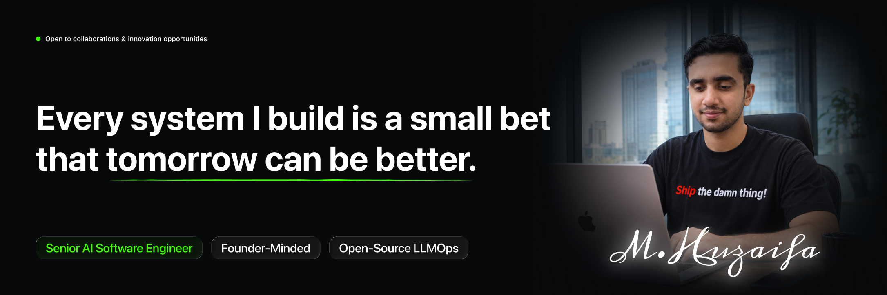

**Thanks for stopping by.**

# Muhammad Huzaifa Shahbaz

**Senior AI Software Engineer  ·  Applied AI Researcher  ·  Consultant**  
AI products, production infrastructure, research and developer education.

### Hi, I'm Huzaifa

I build AI products and the software behind them. Things that search documents, hold conversations, make recommendations and keep data moving when lots of people show up at once.

At **[Digital Dividend Global](https://digital-dividend.com)**, I work on AI systems and backends. I also help teams across the US, UK, GCC and Europe turn their ideas into working products.

I write research, teach workshops and build things on weekends. Those usually start with “this should be a small project”. GitHub has the evidence.

 

## A few things I've built

Some client work, some personal projects. Click a cover to see the details.

| Preview                                                                                                                    | Project & my contribution                                                                                                                                                                                                                                                                                                                                                                                   |
| :------------------------------------------------------------------------------------------------------------------------: | :---------------------------------------------------------------------------------------------------------------------------------------------------------------------------------------------------------------------------------------------------------------------------------------------------------------------------------------------------------------------------------------------------------- |
|           | **OptyAI / OptySleep** Built the engine that suggests sleep methods based on a person's history, plus the API and caching behind it. Yes, I work on sleep software. The irony is documented. Python · FastAPI · recommendations [Case study](https://mhuzaifa.com/portfolio/optysleep) · [App Store](https://apps.apple.com/us/app/optysleep/id6458265948)                                                  |
|          | **Voca** Built AI calling workflows, campaign tools and CRM connections so teams can manage outreach in one place. Python · FastAPI · voice AI [Case study](https://mhuzaifa.com/portfolio/ai-voice-call-agent) · [Website](https://voca.codefied.online)                                                                                                                                                   |
|             | **Staging Pro 2.0** Built the backend that keeps race dashboards and connected devices in sync, including live updates and race control. Django · WebSockets · IoT [Case study](https://mhuzaifa.com/portfolio/staging-pro) · [App Store](https://apps.apple.com/us/app/staging-pro/id6503903450)                                                                                                           |
|                | **VikingRAG SDK** Built an independent Python SDK for searching structured documents while keeping their sections and source evidence intact. Inspired by Gao et al.'s VikingRAG paper. Python · PostgreSQL · pgvector [Code](https://github.com/mhuzaifadev/VikingRAG) · [PyPI](https://pypi.org/project/vikingrag/) · [Evaluation](https://github.com/mhuzaifadev/VikingRAG/blob/main/docs/EVALUATION.md) |
|          | **ViralMe Studio** Built browser-based video editing and rendering workflows, with AI-assisted effects and background processing. Remotion · Node.js · Python [Case study](https://mhuzaifa.com/portfolio/viralme-studio) · [Website](https://viralme.studio)                                                                                                                                               |
|  | **AI Legal Assistant** Built document search and question-answering tools that help users find relevant legal information with source citations. Gemini · LangChain · MongoDB [Case study](https://mhuzaifa.com/portfolio/ai-legal-assistant)                                                                                                                                                               |
|          | **PseudoCompiler** Built a tool that translated AQA pseudocode into Python, ran it and streamed the output. A past project for making code easier to learn. Python · FastAPI · WebSockets [Case study](https://mhuzaifa.com/portfolio/pseudocompiler) · [Demo video](https://pub-dad81fab22374f8d9876aa00f95e9802.r2.dev/PortfolioVideos/pseudocompiler.webm)                                               |
|                    | **Remove BG** Built a free tool that removes image backgrounds. For when you like the photo, just not everything standing behind you. U2Net · FastAPI · PWA [Case study](https://mhuzaifa.com/portfolio/removebg) · [Try it](https://removebg.mhuzaifa.com)                                                                                                                                                 |

[More projects and technical details →](https://mhuzaifa.com/portfolio)

## Professional background

| Organisation | Role / focus |
| :--- | :--- |
| **[Digital Dividend Global](https://digital-dividend.com)** | AI Systems Engineer. Building AI features, APIs and the infrastructure that runs them. |
| **[Lenaar Digital LLC](https://lenaardigital.com)** | Built backends, deployed cloud services and connected AI models to real products. |
| **[AKDN Digital Health Resource Centre](https://the.akdn/en/how-we-work/our-agencies/aga-khan-health-services/digital-health-resource-centre)** | Worked on AI research using mammography and ultrasound images for breast cancer detection. |
| **[Virufy](https://virufy.org)** | ML research internship exploring cough and breath audio for COVID-19 detection. |
| **Independent consulting** | AI systems and backend engineering for international product teams. |

[Experience, projects and credentials →](https://mhuzaifa.com/resume)

## Research & publications

I've worked on research in emotion recognition, medical imaging and prediction models. Here are my co-authored publications and a Python book for young learners.

| # | Paper | Venue | Year |
|---|-------|-------|------|
| 1 | [AI-Assisted Seismic Performance Assessment of High-Rise Structures](https://doi.org/10.5281/zenodo.20305243) | Spectrum of Engineering Sciences | 2026 |
| 2 | [The Future of Third Web: Blockchain & Web 3.0](https://dx.doi.org/10.1504/IJESDF.2025.145880) | IJESDF | 2025 |
| 3 | [Enhancing Contextualized GNNs for Multimodal Emotion Recognition](https://ieeexplore.ieee.org/document/10178481) | IEEE IMTIC'23 | 2023 |
| 4 | [DenseNet121 on Pre-processed MIAS Dataset](https://ieeexplore.ieee.org/document/10064663) | IEEE GCWOT'23 · Málaga, Spain | 2023 |
| 5 | [Karachi Stock Price Prediction with LSTM](https://doi.org/10.21015/vtse.v11i2.1571) | VFAST Transactions | 2023 |
| 📖 | [PyKids — Python for Kids](https://www.amazon.com/dp/B0C1YBFWZV) · ISBN 9798390752586 | Amazon Kindle | 2023 |

[Full bibliography](https://mhuzaifa.com/publications) · [Google Scholar](https://scholar.google.com/citations?user=UG6fYWwAAAAJ) · [ORCID](https://orcid.org/0000-0002-0043-6037)

## Teaching, speaking & community

I teach AI and software engineering through workshops, talks and mentoring. I've also led developer communities and judged hackathons. Explaining a model to a room of students is an excellent way to find out whether you understand it yourself.

| Contribution | Community / organisation | Period |
| :--- | :--- | :--- |
| Hackathon judging & workshop delivery | DHA Suffa University · Folio3 · NED | 2025–2026 |
| Campus community leadership | Google Developer Student Clubs · Lead, 2020–2021 | 2019–2021 |
| Student Ambassador | Microsoft Learn Student Ambassadors | 2020–2023 |
| Bootcamp instruction | ML Zero to Hero · Deep Learning MasterClass | 2020 |

[Talks, workshops and event records →](https://mhuzaifa.com/speaking)

## Tech stack

**AI / LLM layer** — LangChain · LangGraph · HuggingFace · Ollama · OpenAI · ElevenLabs · Retell AI · Whisper · YOLO · SAM2 · PEFT/LoRA · Unsloth

## GitHub activity

## Outside the build

- Python is usually my first choice. Occasionally, it gets a say too.
- I like explanations that make sense without opening twelve browser tabs.
- “One last change” is a phrase I'm learning to use more responsibly.

## Let's connect

Building something useful, planning a workshop or exploring a research idea? [Tell me about it](mailto:mhuzaifadev@gmail.com). Plain English is welcome; a 40-slide pitch deck is optional.

